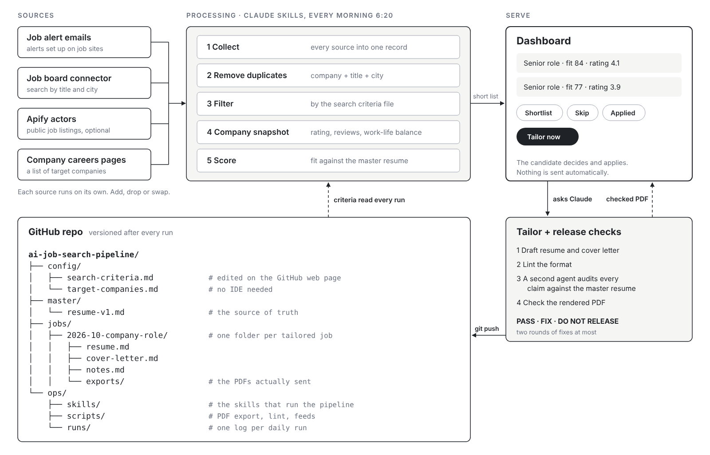

# Morning job scan

A job search that runs itself every morning. It collects roles from your job alert emails, job boards and the careers pages of companies you want to work for, removes duplicates, filters them by your own criteria, adds a company rating snapshot, scores each role against your resume, and puts a short list on a dashboard. When a role looks right, one click drafts a tailored resume and cover letter, which pass an independent check before they are released. Every version is kept in this repo.

It is built for [Claude](https://claude.ai): the logic lives in skills (plain Markdown instructions), the run is a Claude scheduled task, and the dashboard is a Claude artifact. The idea isn't tied to Claude, but other assistants would need some adapting.

## What it will not do

It never applies or contacts anyone on your behalf. It finds, filters, drafts and logs. You decide, and you apply.

Don't trust the tailored resume or cover letter blindly. The release check catches a lot, but read every draft yourself before you send it.

## What you need

- A Claude plan that supports scheduled tasks
- A GitHub account (keep your copy of this repo **private**, since your resumes will live in it)
- Optional: an email inbox for job alerts, a job-board connector such as Indeed, a search connector such as Parallel Search, and an Apify account for extra job-board and careers-site coverage

Without Apify the running cost is zero. With it, a typical month stays within Apify's free monthly credit.

## Set it up

1. Fork or copy this repo into your own GitHub account. Keep it private.
2. Fill in `config/search-criteria.md` and add your target companies to `config/target-companies.md`. Copy `config/workday-settings.example.json` to `config/workday-settings.json` and fill it in.
3. Add your master resume as `master/resume-v1.md`, in the format shown in `master/README.md`.
4. In Claude, connect GitHub and whichever job sources you want: an email inbox with job alerts, a job-board connector, a search connector, Apify.
5. Add the three skills in `ops/skills/` to Claude.
6. Ask Claude to build your dashboard from `ops/dashboard/` and to set up the daily scheduled task.

You can also point your AI assistant at this repo and ask it to walk you through these steps. You only need to connect your accounts, add your resume and fill in your search criteria yourself.

### For your AI assistant

If you are an AI assistant helping someone set this up, work through these steps with them and ask before anything you can't undo:

1. Confirm they have their own **private** copy of this repo, and attach it with push access.
2. Help them fill in `config/search-criteria.md` by asking about the role, locations, pay, sectors and exclusions. Don't invent answers.
3. Help them build `config/target-companies.md`. For each company, find its careers source, test whether it can be read, and set the Access column (`Workday feed ✓`, `Search page ✓`, `Not mapped` or `Blocked`). Put working search-page URLs in `config/search-pages.md`.
4. Convert their resume to the format in `master/README.md` without changing any fact, save it as `master/resume-v1.md`, and ask them to check it line by line.
5. Fill in `config/setup.md` with them.
6. Publish `ops/dashboard/index.html` as an artifact with the `db`, `user`, `sample` and `downloads` capabilities. Store the master resume in its `config/master-resume` document (`version`, `updated`, `markdown`). Put the link in `config/setup.md`.
7. Install the three skills from `ops/skills/`.
8. Run the job scan once with them watching, then create a daily scheduled task that runs `ops/skills/job-scan/SKILL.md` at the time in `config/setup.md`.

## Before you switch on a source

Check each job site's terms before you switch on a source that reads it. The setup sticks to public job listings and does not touch LinkedIn profiles.

## Repo layout

| Path | Holds |
|---|---|
| `config/` | Your search criteria, target companies, search pages and setup values. Edit these; the next run follows them. |
| `master/` | Your master resume, one file per version (`resume-v1.md`, `resume-v2.md`, …), plus exports |
| `jobs/YYYY-MM-company-role/` | One folder per tailored job: `resume.md`, `cover-letter.md`, `notes.md`, `exports/` |
| `alerts/` | Job alert emails added by hand, if no inbox is connected |
| `outreach/` | Your own log of recruiter and company contacts |
| `ops/skills/` | The three skills: `job-scan`, `resume-tailoring`, `resume-release-check` |
| `ops/scripts/` | Helper scripts: Markdown lint, PDF export, PDF checks, Workday feed scanner |
| `ops/runs/` | One log per daily run |
| `ops/dashboard/` | Source of the dashboard page |

## The ideas behind it

- **Versioning.** Every tailored resume sits in its own folder next to the master it came from, so you always know which version went to which company.
- **Config separate from code.** Your criteria are a plain Markdown file you can edit in the GitHub web page. No code changes.
- **Modular sources.** Each source runs on its own. If one fails, the run logs it and carries on. Add, drop or swap sources as you like.
- **Testing before release.** A lint step, then a second agent that never saw the draft checks every claim against your master resume and inspects the actual PDF.

## Similar projects

[career-ops](https://github.com/santifer/career-ops) by Santiago Fernández de Valderrama takes a similar approach with AI CLI; it scores job offers, generates tailored CVs and tracks applications from the terminal. 
This repo differs in running on a daily schedule inside Claude, serving results to a dashboard, keeping the search criteria as a plain file you edit on GitHub, and gating every tailored resume behind an independent release check.

## License

MIT. See [LICENSE](LICENSE).
